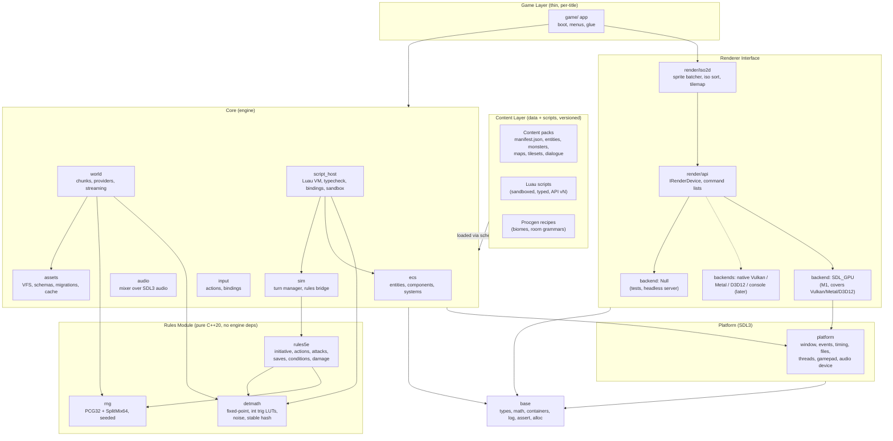

# Engine Architecture & Roadmap

> Status: **Draft v0.2** · 2026-10-13 · Owner: Zach Nava
> Scope: 2D isometric, turn-based RPG engine on the D&D 5e SRD 5.1 ruleset.
> Stack: C++20, SDL3, Luau, CMake. Targets: Windows, macOS, Linux first; consoles/mobile later.

---

## Decisions Log

Decisions here are settled. Reopening one needs a new entry that supersedes it; existing entries are never edited.

| ID | Date | Decision | Consequences |
|---|---|---|---|
| D-001 | 2026-10-13 | **Ruleset: D&D 5e SRD 5.1 (CC-BY-4.0).** | Attribution is mandatory (see Licensing note). Only SRD content and terms are used. SRD 5.2 is out of scope; the `rules_profile` field (§3.5) keeps a hook for it. |
| D-002 | 2026-10-13 | **Language: C++20.** | `CXX_STANDARD 20`, no extensions. C++20 guarantees two's-complement and arithmetic right shift, which the integer and fixed-point math in §4 relies on. |
| D-003 | 2026-10-13 | **Platform layer: SDL3.** SDL_GPU is the first render backend. | No SDL outside `platform`/`render_*` (§2.2). Native Vulkan/Metal/D3D12 backends only when they are needed. |
| D-004 | 2026-10-13 | **Desktop first: Windows, macOS, Linux.** | CI matrix and determinism checks cover these three from M0. Other devices come later, via new backend + platform code only. |
| D-005 | 2026-10-13 | **Scripting: Luau** (not PUC Lua). The built-in Luau sandbox is used. Pack scripts are type-checked against versioned Luau type definitions at pack load. | §3.3 scripting host design. `.luau` files. No sol2; bindings are generated from `api.def`. Type definitions are immutable per API level. |
| D-006 | 2026-10-13 | **Cross-platform bit-identical determinism** for rules, simulation, streaming, and procedural generation. Seeds are shareable. | §4. Own PRNG, no `std::` distributions, integer/fixed-point math in sim and gen, own noise, stable iteration order. Scripts get randomness and math only through engine APIs. Golden-hash CI runs on all three OSes. |
| D-007 | 2026-10-13 | **Generator versions are permanent.** `gen_version` is an input to every chunk seed (`derive_seed(world_seed, {tag, gen_version, x, y, level})`), and every shipped generator version stays callable forever, so an old seed string plus its `g<N>` always rebuilds the same world. | `procgen::generate` dispatches through an append-only table keyed by `gen_version`. Each version has golden content hashes that must never change; a test fails if a registered version lacks goldens or a golden version stops generating. Changing output means adding a new version, never editing an old one (§4.6). |
| D-008 | 2026-10-24 | **Engine code: Apache License 2.0.** SRD-derived content stays CC-BY-4.0 (D-001) and carries the Wizards attribution. | `LICENSE` is the Apache 2.0 text. `NOTICE` states the split and quotes the SRD 5.1 attribution. Supersedes the open license choice in §9 item 10. |

## 0. Principles

1. **Engine ≠ game.** The engine ships no game content. Games are *data + scripts* loaded through versioned contracts.
2. **Content written for v1 still runs on v3.** Schemas are versioned and migrated at load; the script API only ever grows.
3. **Rules are pure.** The 5e rules module is a deterministic C++ library with zero engine dependencies. Same seed + same inputs = same outcome, on every platform.
7. **Bit-identical everywhere.** Gameplay state, streamed worlds, and generated worlds are identical byte for byte on Windows, macOS, and Linux for the same seed and content (§4).
4. **One world format.** Handcrafted, streamed, and procedurally generated worlds all produce the same `Chunk`.
5. **Lightweight, modular.** Each module is a static lib with a narrow public header set. No module may reach into another's `src/`.
6. **Interfaces before implementations.** Milestone 0 is contracts; code fills them in.

### Licensing note (engine code and SRD 5.1)
Engine code is Apache License 2.0 (D-008). See `LICENSE` at the repository root.

SRD 5.1 content is licensed CC-BY-4.0. Every distribution that includes SRD-derived data (engine sample content, `rules` data tables, docs) must carry this notice, in `NOTICE`, the in-game credits, and any data pack's `manifest.json` (`attribution` field). The wording below is the attribution from the SRD 5.1 CC-BY-4.0 release:

> This work includes material taken from the System Reference Document 5.1 (“SRD 5.1”) by Wizards of the Coast LLC and available at https://dnd.wizards.com/resources/systems-reference-document. The SRD 5.1 is licensed under the Creative Commons Attribution 4.0 International License available at https://creativecommons.org/licenses/by/4.0/legalcode.

Use only SRD terms. Do not use Wizards trademarks or non-SRD content (e.g. "Dungeons & Dragons" branding, non-SRD monsters or subclasses). The pack loader enforces that the attribution field is present (§3.6).

---

## 1. Layer Diagram



Note: **SDL_GPU already sits on top of Vulkan, Metal, and D3D12.** That makes it the right single M1 backend. It gives us all three desktop OSes with one implementation. Native backends are only justified for platforms SDL_GPU doesn't cover (consoles, WebGPU) or for measured performance gaps. The `IRenderDevice` abstraction exists so those can be added without touching `iso2d` or game code.

---

## 2. Module Boundaries & Dependency Rules

### 2.1 Modules

| Module | Kind | May depend on | Public surface |
|---|---|---|---|
| `base` | static lib | std only | math, `Span`, `Handle<T>`, logging, asserts, allocators |
| `rng` | static lib | std only | `Pcg32`, `splitmix64`, `derive_seed`, deterministic `uniform`/`shuffle` |
| `detmath` | static lib | std, xxHash (header-only, `StableHash` = xxHash3-64, §4.5) | `Fx` (Q16.16), int `sqrt`, LUT trig, value/gradient noise, `StableHash` (§4) |
| `rules5e` | static lib | `rng`, `detmath`, std | `rules5e/*.hpp`: pure functions + value types |
| `rules5e_content` | static lib | `rules5e`, `assets` | `spell@1` JSON → `rules5e::SpellDef` / `SpellBook` (keeps `rules5e` free of JSON) |
| `platform` | static lib | `base`, SDL3 | window, event pump, clock, file I/O, threads, audio device |
| `render_api` | header + lib | `base` | `IRenderDevice`, resources, command lists |
| `render_sdlgpu` | static lib | `render_api`, `platform`, SDL3 | `create_sdlgpu_device()` |
| `render_null` | static lib | `render_api` | `create_null_device()` |
| `iso2d` | static lib | `render_api`, `base` | sprite batcher, iso projection, depth sort, tilemap renderer |
| `assets` | static lib | `base`, `platform` | VFS, pack mounting, schema registry, migrations, typed cache |
| `ecs` | static lib | `base` | registry, components, system scheduling |
| `world` | static lib | `assets`, `ecs`, `base`, `rng`, `detmath` | `Chunk`, `IChunkProvider`, `ChunkStreamer`, procgen runtime |
| `procgen` | static lib | `detmath`, `rng`, `base` | seed strings, chunk seeds, room/corridor generator → `chunk@1` data (no world types) |
| `procgen_world` | static lib | `world`, `procgen` | glue: `ProceduralProvider` (procgen output → `world::Chunk`) |
| `audio` | static lib | `assets`, `platform` | buses, one-shots, music |
| `sim` | static lib | `ecs`, `rules5e`, `world` | turn manager, ECS ↔ rules adapters |
| `script_host` | static lib | `ecs`, `sim`, `world`, `assets`, `rng`, `detmath`, Luau (VM, Compiler, Analysis) | API vN bindings, sandbox, pack-load typecheck |
| `engine` | static lib | all core modules | `Engine` facade: main loop, service wiring |
| `game/*` | executable | `engine`, `iso2d` | per-title boot code (kept tiny) |
| `tools/*` | executables | `assets`, `world`, `rules5e` (no renderer unless editor) | packer, validator, migrator, procgen preview |

_Lint exception (approved): `tools/*` may also depend on `script_host` (`script_check`, the pack typecheck half of the validator) and on `procgen`/`procgen_world` (`procgen_dump`, the procgen preview). Still no renderer or platform, and no direct third-party links. Enforced by `tools/depcheck/rules.cmake` (`ALLOW_KIND_tool`)._


### 2.2 Rules (enforced in CI)

1. **Acyclic, downward only.** Dependencies flow strictly down the table/diagram. CI checks this with a CMake target-graph script (`tools/depcheck`).
2. **`rules5e`, `rng`, and `detmath` have no engine dependencies.** No SDL, no ECS, no assets, no I/O, no globals, no clocks, no threads. They compile standalone with `-DRULES_STANDALONE`, built in their own CI job.
3. **No SDL outside `platform` and `render_*`.** Other modules see only engine types. `#include <SDL3/...>` elsewhere fails the lint step.
4. **Backends are leaves.** Nothing includes a backend header except `engine` (factory selection) and tests.
5. **Public headers in `include/<module>/`, private in `src/`.** Linking happens via `target_link_libraries(... PUBLIC|PRIVATE)`, never via include paths into another module's `src/`.
6. **Content never links.** Content reaches the engine only through (a) schema-validated data and (b) the typed Luau API. No native plugins in content packs (security and compatibility).
7. **Game layer can't patch engine internals.** If `game/` needs something, it goes into a public engine API with a version bump.
8. **Determinism boundary.** Anything that affects simulation or world state (`sim`, `rules5e`, `world` procgen and streaming, scripts in sim/gen context) follows §4. Floats are allowed only in presentation (`iso2d`, `render_*`, `audio`, camera, UI), and presentation output is never fed back into state. CI enforces this with a lint over the `rules5e`, `rng`, `detmath`, `sim`, and `world/gen` sources (§4.7).

---

## 3. Content Compatibility Contract

The promise: **a content pack that loads cleanly on engine vX loads and behaves the same on any later version, for as long as its feature level is still supported (§3.5).**

Feature effect kinds, base-damage, range and tile-flag rules: see [CONTENT_EFFECTS.md](CONTENT_EFFECTS.md).

### 3.1 Versioning axes

| Axis | Format | Bumped when | Example |
|---|---|---|---|
| Engine version | SemVer `MAJOR.MINOR.PATCH` | releases | `3.1.0` |
| Schema version (per type) | integer, monotonic | any change to a data type's shape or meaning | `"monster": 4` |
| Script API level | integer, monotonic | any API added | `api_level: 7` |
| Feature level | integer | bundle of schema+API levels a pack targets | `feature_level: 1` |

Each data file declares `"$schema": "<type>@<version>"`. Each pack manifest declares `engine_min`, `api_level`, and the `capabilities` it requires.

### 3.2 Schema evolution & migrations

- Schemas live in `schemas/<type>/v<N>.schema.json` (JSON Schema 2020-12) and are **immutable once released**.
- For each step `N → N+1` there's a migration function, registered in `assets`:
  ```cpp
  ASSET_MIGRATION("monster", 3, 4, [](Json& j, MigrationCtx& ctx) {
      // v4: "hp" split into "hit_points": {"average", "formula"}
      auto hp = j.take("hp");
      j["hit_points"] = {{"average", hp}, {"formula", ctx.derive_hp_formula(j)}};
  });
  ```
- At load: read the file → validate against **its declared** version → run the migration chain to current → validate against current → deserialize. Migrations are pure `Json → Json` functions with no I/O.
- Migrated output can be cached (`.cache/` keyed by content hash plus engine schema set). The source file is never rewritten at runtime. `tools/migrate` rewrites files on disk only when an author runs it explicitly.
- **Golden corpus:** `tests/content_compat/v<N>/` holds frozen packs from every released feature level. CI loads every one on every commit, checks that it validates, and diffs simulation replays (§7, M1 compat test).

### 3.3 Scripting host (Luau) & API stability

**Runtime.** Luau is pinned to a release tag and vendored through `cmake/Dependencies.cmake`. Three Luau components are used: `Luau.VM`, `Luau.Compiler`, and `Luau.Analysis`. Bindings are a thin in-house layer generated from `script_host/api/api.def` (no sol2). The engine compiles `.luau` source itself with `luau_compile`. **Packs never ship bytecode.** The bytecode cache is keyed by `(source hash, Luau version, api_level)`.

**Sandbox (built-in Luau mechanisms):**
- One `lua_State` per pack context (sim, gen, ui). Load only the safe libraries (`base`, `string`, `table`, `math`, `bit32`, `utf8`, `coroutine`, `buffer`). Then remove the non-deterministic or unsafe entries: `os` entirely, `loadstring`, `getfenv`/`setfenv`, `collectgarbage` beyond `"count"`, and `debug` except `traceback`. Then install engine globals, then call **`luaL_sandbox(L)`**. Builtins and globals become read-only and the global table is frozen.
- Each script runs in its own **`luaL_sandboxthread`**. It gets a private global table that falls back to the frozen one, so scripts can't tamper with each other or with the engine.
- `require` is replaced by a resolver limited to the pack and its declared `depends` (no filesystem paths).
- **CPU budget:** a `lua_callbacks(L)->interrupt` handler counts instructions/time slices per call and raises an error over budget. Gen contexts use an instruction count only (no wall clock), so outcomes don't depend on machine speed.
- **Memory cap:** a custom `lua_Alloc` per state, with a hard limit per context.
- Engine objects are exposed as opaque, generation-checked userdata handles, never raw pointers.
- **Native codegen (`Luau.CodeGen`) is off** in sim and gen contexts until it passes the §4 golden-hash suite on all targets. It may be on for ui.

**Typed content API (checked at pack load):**
- `api.def` generates one immutable Luau definitions file per API level: `script_host/api/generated/engine.level<N>.d.luau`. Each file uses Luau definition syntax: `declare extern type <Name> with ... end` for handle classes and engine types (event payloads, `Fx`/`Rng`), and `declare function` / `declare <name>: <type>` for engine globals. (The older `declare class` form is not accepted by the pinned Luau.) It also generates Luau types for data schemas (e.g. `type Monster = {...}` from `monster@N`), so scripts that read content data are checked too.
- At pack load, `script_host` runs `Luau::Frontend` in **strict mode** on every pack script (overriding any `--!nonstrict`/`--!nocheck` header). It loads the definitions file for the pack's declared `api_level`. **Any type error fails the pack load** with `file:line: message`. Lint warnings, such as deprecated API use, are reported but don't fail the load.
- Results are cached by `(script hash, api_level, Luau version)`, so the check costs nothing on unchanged packs. `tools/validate` runs the same check offline.
- The same `.d.luau` files ship in the SDK so authors get editor checking via luau-lsp.

**Stability rules:**
- **Append-only.** Functions, fields, and events can be added. They are never removed, renamed, or changed in signature or semantics within a supported feature level. A released `engine.level<N>.d.luau` is byte-frozen; CI diffs it against the archived copy.
- Scripts are bound to the manifest's `api_level`. The environment exposes **only** symbols with `introduced <= api_level`, and the type check uses that level's definitions, so a level-1 script can't call a level-3 function, even dynamically. When behaviour must change, the old semantics stay behind the old level (`engine.v1.move_to` vs `engine.v4.move_to`).
- The golden corpus (§3.2) is re-type-checked against its own level's definitions on every commit.
- **Determinism API:** sim and gen scripts get randomness **only** via `ctx.rng` (an engine `Pcg32` stream) and math **only** via `fx.*` (fixed-point) and integer ops (§4.5). In those contexts `math.random`, `math.randomseed`, `math.noise`, and libm-backed `math.*` (`sin`, `cos`, `exp`, `log`, `pow`, …) are removed before `luaL_sandbox`.

### Example typed script (`scripts/ai/skirmisher.luau`)

```lua
--!strict
-- api_level 1 (from manifest); types come from engine.level1.d.luau
local function choose(ctx: SimContext, self: CombatantHandle): ActionRequest
    local foes = ctx.encounter:enemies_of(self)            -- {CombatantHandle}, stable order
    table.sort(foes, function(a, b)                        -- total order: hp, then stable id
        local ha, hb = a:hp(), b:hp()
        if ha ~= hb then return ha < hb end
        return a:id() < b:id()
    end)
    local target = foes[1]
    if self:hp() * 4 < self:hp_max() and ctx.rng:chance(1, 2) then  -- integer odds, no floats
        return { kind = "disengage", actor = self }
    end
    return { kind = "attack", actor = self, target = target, attack = "scimitar" }
end

return { choose = choose }
```

### 3.4 Capability flags

- Packs declare `"requires": ["iso.tiles.v1", "rules.srd51", "world.procgen.v1"]` and an optional `"optional": [...]`.
- The engine publishes the capabilities it provides. At load, a missing required capability gives a clear error ("pack needs `world.procgen.v1`, engine provides …"). Missing optional ones get a script-queryable flag (`engine.has("audio.spatial.v1")`).
- Capabilities are never reused with new meaning. A changed meaning gets a new `.vN` suffix.

### 3.5 Deprecation policy

1. **Mark:** schema field or API marked `deprecated_in: X.Y`. The loader warns once per pack, and `tools/validate` lists them.
2. **Keep:** deprecated items stay functional for **at least 2 engine MAJOR versions** and at least 24 months, whichever is longer.
3. **Retire:** removal happens only by dropping a whole *feature level* in a MAJOR release, announced one MAJOR ahead. Even then, the migration chain from that level stays in the codebase (the cost is small), so `tools/migrate` can still upgrade old packs offline.
4. Semantic changes to rules outcomes (e.g. an SRD errata fix) are treated as breaking. They go behind a `rules_profile` the pack opts into (`"rules_profile": "srd51-2023"`).

### 3.6 Pack manifest (example)

```json
{
  "$schema": "manifest@1",
  "id": "com.example.sunken_keep",
  "version": "1.2.0",
  "engine_min": "1.0.0",
  "feature_level": 1,
  "api_level": 1,
  "rules_profile": "srd51",
  "requires": ["iso.tiles.v1", "rules.srd51"],
  "optional": ["audio.spatial.v1"],
  "depends": [{ "id": "srd51.core", "version": "^1.0" }],
  "attribution": "This work includes material taken from the System Reference Document 5.1 (\"SRD 5.1\") by Wizards of the Coast LLC ... CC-BY-4.0.",
  "entry_script": "scripts/main.luau"
}
```

---

## 4. Determinism

**Contract:** for the same content (pack ids + versions), engine generator version, and seed, every target produces **bit-identical** state. That covers rules outcomes, simulation state, generated chunks, and the world after any streaming/load order. Presentation (rendering, audio, camera, UI animation) is exempt.

### 4.1 Scope

| Deterministic (bit-identical) | Exempt (may use float, wall-clock) |
|---|---|
| `rules5e`, `sim` turn/state updates, encounter replays | `iso2d`, `render_*`, shaders |
| `world` procgen (`ProceduralProvider`, recipes, noise) | `audio` |
| Chunk streaming outcome (resident set contents, spawns, deltas) | Camera, tweening, particles, UI |
| Save files, `ChunkDelta`, entity `stable_id`s | Profiling, logs, frame timing |
| Luau scripts in `sim` and `gen` contexts | Luau scripts in `ui` context |

### 4.2 Randomness: own PRNG, no `std::` distributions
- **`rng::Pcg32`** (PCG-XSH-RR 64/32) is the stateful stream for rules, sim, and recipe scripts. It has small serializable state (`state`, `inc`), and different stream ids give independent sequences.
- **`rng::splitmix64` / `rng::derive_seed(world_seed, tag, x, y, level, ...)`** derive child seeds statelessly. Every chunk, recipe stage, and encounter gets its own seed from its coordinates, never from "how many numbers were drawn before". This makes generation independent of load order and thread count.
- Bounded ints use **Lemire's multiply-shift with rejection**, implemented in-house. `chance(num, den)`, `d(sides)`, `shuffle` (Fisher-Yates), and `weighted_pick` (integer weights) are all in-house too.
- **Banned in deterministic code:** `std::uniform_*_distribution`, `std::normal_distribution`, `std::shuffle`, `std::random_device`, `rand()`, and `std::hash`. These are implementation-defined and differ between libstdc++, libc++, and MSVC STL.

### 4.3 Math: integers and fixed-point only
- Rules are pure integer math (5e already is). Division rounding is explicit (`div_floor`, `div_round_down` per SRD "round down").
- Gen, sim positions, and pathing costs use **`detmath::Fx` = Q16.16 in `int32_t`** with `int64_t` intermediates. If world-scale coordinates need it, there is a `Fx64` Q32.32 (§9). There are saturating/explicit-overflow helpers. Signed overflow is UB, so it's caught by UBSan in CI.
- `sqrt` is integer Newton iteration. `sin`/`cos`/`atan2` come from **committed lookup tables** (generated once offline, checked into `detmath/tables/`), never from libm at runtime.
- Data files carry numbers that feed sim/gen as integers or decimal strings (`"1.25"`). `detmath::parse_fx` converts those exactly; `strtod` is never used for state.
- Floats appear only in presentation. Converting `Fx → float` for rendering is one-way.
- Build flags as defence in depth (not the guarantee): `-ffp-contract=off`, no `-ffast-math`, MSVC `/fp:precise`; x86-64 and arm64 only.

### 4.4 Noise and generation algorithms
- **Own noise functions in `detmath::noise`:** integer value noise, gradient noise on a hashed integer lattice, fractal sum (octaves), and domain warp, all in `Fx`. Lattice hashing uses `StableHash` of `(seed, ix, iy, octave)`. No third-party float noise libraries (FastNoise etc.).
- WFC, BSP rooms, cellular automata, and Poisson-disc sampling are implemented over integer grids with `Pcg32` streams derived per chunk/stage.
- Cross-chunk features (rivers, roads) come from coarse "region" passes, seeded by region coordinates, that every chunk in the region can recompute identically. No chunk depends on a neighbour having been generated first.

### 4.5 Ordering and state
- **Stable iteration order:** never iterate `std::unordered_*` or pointer-keyed containers where order affects state. Use sorted vectors, `std::map`, or insertion-ordered maps. Entities are processed in `stable_id` order, and spawns in `(chunk coord, stable_id)` order.
- Sorting in deterministic code needs a **total order** (tie-break on a stable id) or `std::stable_sort`.
- `stable_id` = `StableHash(chunk coord, origin, local index)`, so it's the same whether a chunk was streamed, generated, or loaded from a save.
- **Streaming:** a chunk's contents are a pure function of `(provider, coord, seed)` plus its `ChunkDelta`. The streamer integrates finished loads on the main thread in coord order per frame, and sim never observes "partially loaded" chunks. Thread count and load timing can't change state.
- **Hashing** for golden tests uses `StableHash` (xxHash3-64) over a **canonical serialization** (explicit little-endian, no struct padding, no pointers), never over raw memory.
- Byte-level portability: use `uint8_t` (not `char`; signedness differs on ARM Linux) and fixed-width ints only. Never depend on `sizeof(long)`.
- **Luau in sim/gen contexts:** randomness only via `ctx.rng`, math via `fx.*` plus integer arithmetic on numbers within ±2^53 (`//` floor division, `bit32`). Iterate tables with `ipairs` or the engine's `sorted_pairs`. `pairs` over hash tables is flagged by a pack-load lint in those contexts. No time sources (`os` is removed).

### 4.6 Shareable seeds
- A shared seed is a string: `<gen_version>-<base32(seed64)>`, e.g. `g1-K3QZ7M2XAB4PE`. `gen_version` names the generator algorithm set. Changing any algorithm output bumps it, and old versions stay available (append-only, as with §3.3), so shared seeds keep working forever.
- The full reproduction key is `seed string + pack ids@versions` (recipes are content). Saves and shared world links store all of it.

### 4.7 Enforcement in CI
- **Golden hashes, committed** in `tests/golden/`:
  - `rules`: replay logs (`seed + [ActionRequest]`) → event-log hash.
  - `gen`: `(seed, recipe pack, coord list of ~256 chunks incl. negatives & region borders)` → per-chunk hash.
  - `stream`: a scripted walk through a world loaded with 1 thread and with N threads, in forward and reversed order, plus delta save/reload → hash of the resident set and the world state.
  - `script`: deterministic Luau recipe and AI outputs.
- Every job in the CI matrix (Windows MSVC, macOS AppleClang arm64, Linux GCC and Clang, Debug and Release) runs the suite. A final **cross-OS compare job** collects every job's hash artifacts and requires them to be equal to each other and to the committed goldens.
- **Lint:** in `rules5e`, `rng`, `detmath`, `sim`, and `world/gen`, these are rejected: `float`/`double`, `<cmath>`, `<random>` distributions, `std::hash`, `std::unordered_*` iteration, `std::chrono`, and `rand`.
- Changing a golden needs a `gen_version`/`rules_profile` bump in the same PR, plus Rules bot approval.

### 4.8 Header sketch — `rng/include/rng/rng.hpp`, `detmath/include/detmath/fx.hpp`

```cpp
namespace rng {
constexpr uint64_t splitmix64(uint64_t& x) noexcept;
uint64_t derive_seed(uint64_t parent, std::span<const int64_t> keys) noexcept;  // order-sensitive

class Pcg32 {                                    // PCG-XSH-RR 64/32
public:
    Pcg32(uint64_t seed, uint64_t stream) noexcept;
    uint32_t next_u32() noexcept;
    uint32_t below(uint32_t bound) noexcept;     // Lemire, unbiased
    int32_t  range(int32_t lo, int32_t hi) noexcept;  // inclusive
    bool     chance(uint32_t num, uint32_t den) noexcept;
    int      d(int sides) noexcept { return int(below(uint32_t(sides))) + 1; }
    template <class T> void shuffle(std::span<T>) noexcept;  // Fisher-Yates
    struct State { uint64_t state, inc; };
    State save() const noexcept; void load(State) noexcept;
};
using Rng = Pcg32;
}

namespace detmath {
struct Fx {                                      // Q16.16
    int32_t raw;
    static constexpr Fx from_int(int32_t v) { return {v << 16}; }
    friend constexpr Fx operator+(Fx a, Fx b) { return {a.raw + b.raw}; }
    friend constexpr Fx operator*(Fx a, Fx b) { return {int32_t((int64_t(a.raw) * b.raw) >> 16)}; }
    friend constexpr Fx operator/(Fx a, Fx b) { return {int32_t((int64_t(a.raw) << 16) / b.raw)}; }
    auto operator<=>(const Fx&) const = default;
};
Fx  sqrt(Fx);  Fx sin_turns(Fx t);  Fx cos_turns(Fx t);  Fx atan2(Fx y, Fx x);  // LUT-based
std::optional<Fx> parse_fx(std::string_view decimal);   // exact, no strtod
namespace noise {
Fx value2(uint64_t seed, Fx x, Fx y);
Fx gradient2(uint64_t seed, Fx x, Fx y);
Fx fbm2(uint64_t seed, Fx x, Fx y, int octaves, Fx lacunarity, Fx gain);
}
uint64_t stable_hash(std::span<const uint8_t>) noexcept;  // xxHash3-64, canonical bytes
}
```

---

## 5. Interface Sketches (draft)

### 5.1 Renderer interface — `render_api/include/render/device.hpp`

```cpp
#pragma once
#include <cstdint>
#include <span>
#include <string_view>
#include <memory>
#include "base/handle.hpp"
#include "base/math.hpp"

namespace eng::render {

struct TextureTag; struct BufferTag; struct PipelineTag; struct TargetTag;
using TextureId  = Handle<TextureTag>;
using BufferId   = Handle<BufferTag>;
using PipelineId = Handle<PipelineTag>;
using TargetId   = Handle<TargetTag>;   // offscreen render target; TargetId{} = swapchain

enum class Format : uint8_t { RGBA8_UNORM, RGBA8_SRGB, R8_UNORM, D24S8 };
enum class Filter : uint8_t { Nearest, Linear };
enum class Blend  : uint8_t { Opaque, Alpha, Premultiplied, Additive };

struct TextureDesc  { uint32_t w, h; Format fmt; Filter filter = Filter::Nearest;
                      bool render_target = false; std::string_view debug_name; };
struct BufferDesc   { uint32_t size; enum Usage : uint8_t { Vertex, Index, Uniform } usage;
                      bool dynamic = true; };
struct PipelineDesc { std::string_view shader;     // logical name; backend resolves to SPIR-V/MSL/DXIL
                      Blend blend = Blend::Alpha; bool depth_test = false; };

struct DeviceCaps {
    uint32_t max_texture_size;
    bool     supports_compute;
    bool     supports_bindless;
    std::string_view backend_name;  // "sdl_gpu/vulkan", "null", ...
};

// Recorded on any thread, submitted on the render thread.
class ICommandList {
public:
    virtual ~ICommandList() = default;
    virtual void begin_pass(TargetId target, Color clear) = 0;
    virtual void end_pass() = 0;
    virtual void set_pipeline(PipelineId) = 0;
    virtual void set_viewport(RectI) = 0;
    virtual void set_scissor(RectI) = 0;
    virtual void bind_texture(uint32_t slot, TextureId) = 0;
    virtual void bind_vertex_buffer(BufferId, uint32_t offset) = 0;
    virtual void bind_index_buffer(BufferId, uint32_t offset) = 0;
    virtual void push_uniforms(uint32_t slot, std::span<const std::byte>) = 0;
    virtual void draw_indexed(uint32_t index_count, uint32_t first_index,
                              int32_t vertex_offset, uint32_t instance_count = 1) = 0;
};

class IRenderDevice {
public:
    virtual ~IRenderDevice() = default;
    virtual DeviceCaps caps() const = 0;

    virtual TextureId  create_texture(const TextureDesc&, std::span<const std::byte> pixels = {}) = 0;
    virtual BufferId   create_buffer(const BufferDesc&) = 0;
    virtual PipelineId create_pipeline(const PipelineDesc&) = 0;
    virtual void       update_buffer(BufferId, uint32_t offset, std::span<const std::byte>) = 0;
    virtual void       update_texture(TextureId, RectI region, std::span<const std::byte>) = 0;
    virtual void       destroy(TextureId) = 0;
    virtual void       destroy(BufferId) = 0;
    virtual void       destroy(PipelineId) = 0;

    virtual bool          begin_frame() = 0;          // false => skip frame (minimized, lost)
    virtual ICommandList& command_list() = 0;          // valid between begin/end
    virtual void          end_frame() = 0;             // submit + present
    virtual void          on_resize(uint32_t w, uint32_t h) = 0;
};

struct NativeWindow;  // opaque, provided by platform
std::unique_ptr<IRenderDevice> create_sdlgpu_device(NativeWindow&, bool debug);
std::unique_ptr<IRenderDevice> create_null_device();

} // namespace eng::render
```

`iso2d` (above `render_api`) owns the game-facing API: `SpriteBatch::draw(sprite, iso_pos, layer, sort_key)`, `TilemapRenderer::draw(const ChunkView&)`, and the iso projection (2:1 dimetric, tile = 5 ft square, default 64×32 px diamond). Depth sort key = `(layer, iso_y + iso_x, z, entity_id)`, which is deterministic and stable.

### 5.2 Chunk provider — `world/include/world/chunk.hpp`

```cpp
#pragma once
#include <cstdint>
#include <array>
#include <vector>
#include <optional>
#include <string>
#include <string_view>
#include "base/math.hpp"

namespace eng::world {

inline constexpr int kChunkSize = 32;          // 32x32 tiles, 1 tile = 5 ft
inline constexpr int kChunkLayers = 4;         // ground, detail, walls, roof
inline constexpr uint16_t kChunkFormatVersion = 2;   // chunk@2: lights + ambient (R-G13)

struct ChunkCoord {
    int32_t x, y; int16_t level;               // level = floor / dungeon depth
    auto operator<=>(const ChunkCoord&) const = default;
};

using TileId = uint16_t;                        // index into chunk palette

struct TileCell {
    TileId   tile;                              // 0 = empty
    uint8_t  elevation;                         // height steps for iso stacking
    uint8_t  flags;                             // blocks_move | blocks_sight | difficult | water ...
};

struct EntitySpawn {
    std::string  archetype;                     // content id, e.g. "srd51.monster.goblin"
    Vec2i        tile;                          // local to chunk
    uint32_t     stable_id;                     // StableHash(coord, origin, index); same in every origin
    std::string  overrides_json;                // optional per-instance data (schema-validated)
};

struct Chunk {
    uint16_t   format_version = kChunkFormatVersion;
    ChunkCoord coord;
    uint64_t   content_hash;                    // for cache / save diffs
    std::vector<std::string> palette;           // TileId -> tile asset id ("tiles.dungeon.floor_01")
    std::array<std::array<TileCell, kChunkSize * kChunkSize>, kChunkLayers> layers;
    std::vector<EntitySpawn> spawns;
    std::vector<std::string> triggers;          // script hooks / regions (serialized)
    enum class Origin : uint8_t { Handcrafted, Streamed, Procedural } origin;
    // chunk@2 (R-G13 LIGHTING.md §3.3 / §7), appended. Presentation (colour, flicker, glow) is never stored here.
    struct Light {
        Vec2i       tile;                       // local to chunk
        uint16_t    bright_ft = 0, dim_ft = 0;  // multiples of 5; bright + dim <= kMaxLightFt
        uint8_t     flags = 0;                  // 1 magical, 2 sunlight, 4 starts unlit (sim::light_src values)
        std::string preset;                     // content key render maps to visuals ("" = none)
        uint32_t    stable_id = 0;              // computed by the loader (chunk_light_stable_id); never authored
    };
    struct Ambient {
        uint8_t kind = 0;                       // 0 none (underground), 1 sun, 2 moon (sim::AmbientKind)
        uint8_t level = 0;                      // 0 dark, 1 dim, 2 bright (sim::Light)
        auto operator<=>(const Ambient&) const = default;
    };
    std::vector<Light>     lights;
    std::optional<Ambient> ambient;
};
inline constexpr uint16_t kMaxLightFt = 120;    // 24 tiles < kChunkSize: a 1-chunk halo suffices (LIGHTING.md §7)

struct ChunkRequest {
    ChunkCoord coord;
    uint64_t   world_seed;                      // procedural providers MUST be pure in (seed, coord)
    uint16_t   gen_version;                     // generator algorithm set (§4.6)
};

enum class ChunkStatus : uint8_t { Ready, Empty, NotFound, Error };
struct ChunkResult { ChunkStatus status; std::optional<Chunk> chunk; std::string error; };

class IChunkProvider {
public:
    virtual ~IChunkProvider() = default;
    virtual std::string_view name() const = 0;
    virtual bool covers(ChunkCoord) const = 0;               // cheap bounds test
    virtual ChunkResult load(const ChunkRequest&) = 0;       // called on worker threads; must be thread-safe
};

// Concrete providers (all emit the same Chunk):
//   HandcraftedProvider  — reads authored map files (map@N schema) → slices into chunks
//   PackedRegionProvider — reads pre-baked region files for open-world streaming
//   ProceduralProvider   — runs a recipe (Luau gen context or C++) bit-identically from
//                          derive_seed(world_seed, coord); see §4
//   LayeredProvider      — composes providers by priority (handcrafted town inside procedural wilds)
// World deltas (player changes) are stored separately as a ChunkDelta overlay keyed by coord,
// so regenerating/re-streaming a chunk never loses save state.

class ChunkStreamer {
public:
    explicit ChunkStreamer(IChunkProvider& root, uint32_t worker_threads = 2);
    void set_focus(Vec2i world_tile, int16_t level, int radius_chunks);
    void update();                                           // main thread: integrate finished loads
    const Chunk* get(ChunkCoord) const;                      // nullptr if not resident
};

} // namespace eng::world
```

**chunk@2 versioning.** `kChunkFormatVersion` is 2. chunk@2 (R-G13, `docs/proposals/LIGHTING.md` §3.3/§7) appends `lights` and `ambient` to `Chunk`; chunk@1 data is migrated at load time (no lights, no ambient). `content_hash` folds `lights` and `ambient` only when they are non-empty, so chunk@1-equivalent chunks keep their hash. Visual presentation (light colour, flicker, glow) is render-side via `preset` and is excluded from both the struct and the hash.

### 5.3 Rules module entry points — `rules5e/include/rules5e/rules.hpp`

```cpp
#pragma once
// Pure, deterministic SRD 5.1 rules. No engine headers. No I/O. No globals.
#include <array>
#include <cstdint>
#include <span>
#include <string_view>
#include <vector>
#include <optional>
#include "rng/rng.hpp"
#include "detmath/fx.hpp"

namespace rules5e {

enum class Ability : uint8_t { Str, Dex, Con, Int, Wis, Cha };
enum class DamageType : uint8_t { Acid, Bludgeoning, Cold, Fire, Force, Lightning,
                                  Necrotic, Piercing, Poison, Psychic, Radiant, Slashing, Thunder };
enum class Condition : uint8_t { Blinded, Charmed, Deafened, Frightened, Grappled, Incapacitated,
                                 Invisible, Paralyzed, Petrified, Poisoned, Prone, Restrained,
                                 Stunned, Unconscious, Exhaustion };
enum class RollMode : uint8_t { Normal, Advantage, Disadvantage };

using CombatantId = uint32_t;

struct DiceExpr { uint8_t count; uint8_t sides; int16_t bonus; };  // "2d6+3"

struct AbilityScores { std::array<int8_t, 6> score; };
constexpr int modifier(int score) { return (score >= 10 ? score - 10 : score - 11) / 2; }

struct Attack {
    std::string_view id;
    int8_t   to_hit;                     // total bonus
    DiceExpr damage; DamageType type;
    uint8_t  reach_or_range_ft;
    bool     ranged, finesse;
};

struct Combatant {
    CombatantId id;
    uint8_t  team;
    AbilityScores abilities;
    int16_t  hp, hp_max, temp_hp;
    int8_t   ac;
    int8_t   proficiency_bonus;
    uint8_t  speed_ft;
    uint32_t save_proficiencies;        // bitmask over Ability
    uint32_t conditions;                // bitmask over Condition
    uint8_t  exhaustion_level;
    uint32_t resistances, immunities, vulnerabilities;  // bitmask over DamageType
    std::vector<Attack> attacks;
};

struct TurnBudget { bool action = true, bonus_action = true, reaction = true; int16_t movement_ft; };

struct D20Roll { int8_t natural; int8_t natural_other; int16_t total; RollMode mode; };

// ---- Primitives ----
D20Roll roll_d20(rng::Rng&, int modifier, RollMode);
int     roll_dice(rng::Rng&, DiceExpr, bool critical = false);   // crit doubles dice, not bonus

// ---- Initiative ----
struct InitiativeEntry { CombatantId id; int16_t total; int8_t dex_mod; };
// Ties: higher Dex mod first, then rng tiebreak (deterministic given rng state).
std::vector<InitiativeEntry> roll_initiative(rng::Rng&, std::span<const Combatant>);

// ---- Attacks ----
struct AttackContext {
    RollMode mode = RollMode::Normal;     // caller merges sources; adv+disadv => Normal
    bool target_within_5ft = false;       // for Prone/Paralyzed/Unconscious auto-crit rules
    int8_t cover_ac_bonus = 0;            // +2 half, +5 three-quarters
};
struct AttackResult { D20Roll roll; bool hit, critical; int16_t damage; DamageType type; };
RollMode     attack_roll_mode(const Combatant& attacker, const Combatant& target, const AttackContext&);
AttackResult resolve_attack(rng::Rng&, const Combatant& attacker, const Attack&,
                            const Combatant& target, const AttackContext&);

// ---- Saving throws ----
struct SaveResult { D20Roll roll; bool success; bool auto_fail; };
SaveResult saving_throw(rng::Rng&, const Combatant&, Ability, int dc, RollMode = RollMode::Normal);

// ---- Damage / conditions ----
struct DamageApplied { int16_t dealt; int16_t hp_after; bool dropped_to_zero, killed_outright; };
DamageApplied apply_damage(Combatant&, int16_t amount, DamageType);   // resist/immune/vuln, temp HP
void add_condition(Combatant&, Condition);
void remove_condition(Combatant&, Condition);
bool can_take_actions(const Combatant&);   // Incapacitated & co.

// ---- Encounter state machine (pure; engine drives it) ----
enum class ActionKind : uint8_t { Attack, Dash, Disengage, Dodge, Help, Hide, Ready, Move, EndTurn };
struct ActionRequest { CombatantId actor; ActionKind kind; CombatantId target = 0;
                       uint8_t attack_index = 0; int16_t move_ft = 0; };

struct Event;  // tagged union: InitiativeRolled, TurnStarted, AttackResolved, DamageDealt,
               // ConditionAdded, CombatantDowned, EncounterEnded ...  (rules5e/events.hpp)

struct EncounterState {
    std::vector<Combatant>       combatants;
    std::vector<InitiativeEntry> order;
    uint16_t round = 1; uint16_t turn_index = 0;
    TurnBudget budget;
    rng::Rng rng;                         // owned → state is fully serializable & replayable
};

EncounterState     begin_encounter(std::vector<Combatant>, uint64_t seed);
// Validates and applies one action; returns emitted events. Invalid requests change nothing.
struct StepResult { bool ok; std::string_view error; std::vector<Event> events; };
StepResult         step(EncounterState&, const ActionRequest&);
std::vector<ActionRequest> legal_actions(const EncounterState&);   // for AI + UI
std::optional<uint8_t>     winner_team(const EncounterState&);

} // namespace rules5e
```

Movement on the grid is handled by `sim` (pathing; it flags a `Move` with `leaves_reach`, and `rules5e` offers opportunity attacks through a LeavingReach reaction window). `rules5e` validates the movement budget. Replays = `seed + ActionLog`, where each entry is an `ActionRequest` plus the reaction decisions it needed (see Reaction windows). Golden replays are hashed in tests.

#### Sim responsibilities

`rules5e` has no positions, sight, or perception. `sim` owns these and must do them before calling into rules or around it:

1. **Distance and reach.** Set `ActionRequest::target_within_5ft` (Attack, Help-on-attack, Stabilize, readied Attack) and `Move::leaves_reach`, and fill `hooks.in_range` (who can react to a LeavingReach or SpellCast window). Opportunity attacks always count as within 5 ft. Rules trust it for Prone/Paralyzed/Unconscious effects and adjacency checks.
2. **Hide feasibility.** Check sight lines, cover, and obscurement before sending `Hide`. Compare `Combatant::stealth_total` against observers' passive Perception, and clear it when the creature is seen.
3. **Readied Move cost.** A readied `Move` fires as a reaction and is capped only at speed. `sim` charges it against the readier's movement, paths it, and sets `leaves_reach` on the readied response when that path leaves someone's reach.
4. **Ready triggers and chaining.** `sim` fills `hooks.ready_trigger`. Events produced inside a reaction (`Event::reaction_depth >= 1`) and windows nested inside a reaction are skipped unless `hooks.allow_chain` returns true; `sim` or content decides which chains are legal.
5. **Help and Ready in `legal_actions`.** They need adjacency and trigger facts, so `legal_actions` leaves them out. `sim` builds those requests for AI and UI.
6. **Source- and position-dependent conditions.** Charmed (can't attack the charmer; charmer's social advantage), Frightened (source in line of sight; can't move closer), sight/hearing checks for Blinded and Deafened, and grapple escape (contested check, then removing Grappled).

#### Reaction windows

When an action reaches a trigger point, `rules5e` pauses it and opens a reaction window:

| Trigger | Opened by | Reactors | Options | Effect on the paused action |
|---|---|---|---|---|
| `LeavingReach` | `Move` with `leaves_reach` (not after Disengage) | hostile to the mover, `in_range` | each melee attack | opportunity attack; if the mover drops or reaches speed 0, the move stops (`MoveInterrupted`, no movement spent) |
| `BeingHit` | an attack that hits, before damage; or each target of an `AutoHit` spell (Magic Missile; `spell_id` set, `attack_total` 0) | the creature hit | known `AcBonus` spells whose trigger matches (attack hit; or `or_targeted_by` lists the spell), one option per available slot level (Auto takes the lowest), then `hooks.being_hit_options` | AC bump re-evaluates the hit and lasts until the start of the reactor's next turn; a SpellBook AcBonus spends the slot, is itself a spell (counterable when chaining), and its `blocks_spell` (Magic Missile) means damage immunity to that spell meanwhile |
| `SpellCast` | `CastSpell` (and reaction spells such as Shield) | hostile to the caster, `in_range` | known `Counter` spells from the SpellBook (one option per available slot level ≥ the counter's level), then `hooks.spell_cast_options` | countered spells don't resolve (the slot is still spent); a counter is a spell, so it can be countered in turn when chaining is allowed. SpellBook counter: automatic if its slot level ≥ the spell's level, otherwise a spellcasting-ability check, DC `counter_dc_base` (10) + spell level. Hook counters are opaque (level 3, always succeed) |
| `ReadiedTrigger` | any event matching `hooks.ready_trigger` | the readier | fire the readied response | response runs as a reaction; declining keeps the readied action. A readied `Move` with `leaves_reach` opens its own LeavingReach window like any move (SRD), but its events don't fire other readied actions |

- **Eligibility:** reaction unused, not incapacitated, `Combatant::reaction_policy[trigger] != Never`, in range, and at least one option.
- **Polling order:** a policy hook, `hooks.poll_order` (`PollOrderFn(state, eligible_in_initiative_order) -> ids`). The default, `default_poll_order`, is initiative order starting after the current actor, with the current actor last. Every eligible reactor is polled; polling stops early when the paused action can no longer continue.
- **Policies:** each combatant has a policy per trigger. `Ask` needs a decision (see Async decisions). `Auto` takes option 0 without asking; BeingHit Auto only reacts when the bump turns the hit into a miss. `Never` skips the combatant.
- **Budget:** reacting sets `reaction_used`, which resets at the start of the reactor's turn.
- **No chaining:** windows that would open while a reaction resolves are skipped unless `hooks.allow_chain(state, nested_window)` allows them.
- **Window numbering:** `window_seq` comes from `EncounterState::next_window_seq`, which starts at 0 per encounter and goes up by 1 each time a window actually opens (it has at least one eligible reactor). That includes nested and ReadiedTrigger windows. A trigger point with no eligible reactor uses no number. While a request is paused, the state is the pre-request state, so `next_window_seq` is not yet advanced; the pending window's `window_seq` is the number it will consume.
- **Determinism:** `Auto`/`Never` follow from state and aren't logged; every `Ask` decision is.

#### Spellcasting (`rules5e/spells.hpp`)

- **Data:** `SpellDef`s come from content (`spell@1`, `schemas/spell/v1.schema.json`), loaded by `rules5e_content::load_spellbook`, and are handed to rules as `hooks.spells` (`std::shared_ptr<const SpellBook>`). `spell_id = spell_id_of(content id)` (FNV-1a 32) is what requests, events, and logs carry. A `CastSpell` whose id isn't in the book is an opaque spell: rules only run its SpellCast window and spend no slot. Sim/content resolve it.
- **Caster state (`Combatant`):** `spellcasting_ability`, `caster_level` (cantrip scaling), `spell_slots[1..9]` / `spell_slots_max`, Pact Magic `pact_slot_level` / `pact_slots` / `pact_slots_max`, `spells_known`, and `concentration_spell`. `recover_slots_short_rest` restores pact slots; `recover_slots_long_rest` restores all slots. `spend_slot` uses a regular slot first, then a pact slot of that level.
- **Numbers:** `spell_save_dc = 8 + proficiency + mod`; `spell_attack_bonus = proficiency + mod`.
- **Casting:** `ActionRequest{kind = CastSpell, spell_id, spell_level (slot; 0 = cantrip), target, targets}`. Rules check that the spell is known, that it isn't a reaction spell, the slot (level ≥ the spell's), components (`hooks.can_provide_components`, flags V/S/M), targets (`hooks.spell_target_ok`: range, sight, creature type), and the action or bonus action. Then rules spend the slot, end any old concentration (for a concentration spell), open the SpellCast window, and resolve the effect. A countered spell still uses the slot.
- **Effects (`SpellEffectKind`):** `SpellAttack` (spell attack roll; BeingHit window, so Shield works), `Save` (one damage roll for all targets, full or half; and/or a condition plus an `ActiveSpellEffect` with an optional end-of-turn repeat save), `Heal`, `AutoHit` (darts; each target gets a BeingHit window with `spell_id` set, so Shield's `blocks_spell` can stop the darts), `ApplyCondition` (no save), `AcBonus` and `Counter` (reaction spells, offered automatically from `spells_known` when a slot is available). `SpellDef::extra_effects` holds effects 2..n (`SpellEffect`).
- **7.2zi** adds `stabilize` (Spare the Dying; first effect only), `spell_attack.hit_only` (a hit that deals no hit points), and modifier stats `bonus_dash`, `halve_weapon_damage`, `share_damage` plus the `apply_modifier` riders in `spell_keys_zi.hpp` (folded into `modifiers_digest` sub-byte 0x5F, not a new hash tag). `dash_on_cast` grants Expeditious Retreat's cast-turn Dash and is not stored on the modifier row.
- **7.2zj** adds `grant_fly` and `restore` (first effect only) and the save riders in `spell_keys_zj.hpp`: hostile-save advantage, an end when the caster's team damages the target (Charm Person and Suggestion), suppress charmed or frightened, a second damage packet, difficult terrain until the end of the caster's next turn, charm immunity that skips the save, sight and hearing gates, and `ends_on_restoration`. New state folds into `leftover_digest` (0xAA) and `sourced_digest` (0xA7) as sub-byte 0x60. No new hash tag; 0xE3 stays free. Specimens: `tests/validate/fixtures/spell_batch_zj/`. No packs.
- **spell@1 shape:** `effects` is an array of one or more effects. The first carries targeting and scaling; extra effects resolve in order over the same targets (a rider with `applies_to: affected` only for the targets the previous effect hit / failed / healed / received it), do not scale, and reaction effects (`ac_bonus`, `counter`) must stand alone. `apply_condition` applies a condition with no save for the spell's duration (Invisibility); a repeat-save success ends every effect the spell left on that target. Also: `targets{count, creature_type[], max_spread_ft}` (`Combatant::creature_type`, `hooks.targets_within`); `area{shape, size_ft, width_ft?, height_ft?}` (sim passes the creatures inside as `targets`, with no count cap); `auto_hit{distribution any|single|distinct, simultaneous}` (simultaneous: every target reacts before any damage); `spell_attack.beams` (one roll per beam); `repeat_save` start_of_turn|end_of_turn|on_damage; reaction `trigger{kind, or_targeted_by[], requires_sight}` (`hooks.can_see`); `duration` kinds including `until_start_of_caster_turn` (Shield; required for `ac_bonus`); `heal.excludes_creature_type`; `ritual`; `m{text, cost_cp, consumed, item}` (sim/inventory; `item` is the priced-material contract, docs/CONTENT_CONVENTIONS.md section 7); minute/hour casting times (rejected in encounters). Range `touch` maps to 5 ft. The loader (`rules5e_content`) and `tools/validate` enforce the same cross-field rules; `tests/validate/cases` holds one bad doc per rule (ctest `content_validate_negative`, and `rules5e_content_tests` loads each).
- **Runtime ids:** `spell_id_of` (FNV-1a 32). A collision between two content ids is a hard load error, and the validator fails on collisions within a pack and across the packs validated together.
- **Suggested actions:** `legal_actions` lists `CastSpell` for each known action/bonus-action spell, at each available slot level, at each valid target (hostile; same team for healing; creature type; `spell_target_ok`).
- **Scaling:** cantrips add their base dice at each `cantrip_tiers` caster level (5/11/17). Upcasting adds dice, darts, or targets per slot level above the spell's level.
- **Concentration:** damage → CON save, DC max(10, half the damage taken) (`SavingThrowRolled` with `c & 2`). It ends at 0 HP, on death, or on incapacitation (checked after every request), when another concentration spell is cast, or when the spell's last effect ends. Ending it removes the dependent effects and their conditions.
- **Events (appended):** `SavingThrowRolled`, `ConcentrationEnded`, `SpellEffectEnded`, `SpellCheckRolled`. `EncounterState::effects` holds the lasting effects.

#### Async decisions and the action log (API for `sim`)

Player prompts must never block the game loop, so `Ask` is asynchronous:

1. `step(state, request)` returns a `StepResult` with `status`:
   - `Rejected`: invalid; the state is unchanged.
   - `Done`: applied. `events` is the full event list and `logged` is the `LoggedStep` to append to the action log.
   - `NeedsDecision`: paused at a reaction window. `needs` = `NeedsDecision{window_seq, trigger, reactor, trigger_actor, options, window, target, attack_total, target_ac, attack_natural, spell_id, spell_level}`, which is everything a prompt needs. BeingHit shows the attacker (`trigger_actor`) and its `attack_total` against `target_ac` (AC + cover + current reaction bonus; a natural 20 can't be turned). SpellCast shows the caster, `spell_id`/`spell_level`, and the spell's `target`. Fields that don't apply are 0. `pending_decision(state)` returns the same value. `events` are provisional (what happened up to the pause, for UI context). The state is exactly as it was before the request, plus `state.pending`.
2. While `state.pending` is set, every request except the answer is rejected. Answer with `decision_request(needs, react, option)`, which builds an `ActionRequest{actor = reactor, kind = ActionKind::ReactionDecision, decision = ReactionDecision{window_seq, react, option}}`. Rules reject an answer if `window_seq` or the reactor doesn't match, or if the option index is out of range. The answer may be `Done` or another `NeedsDecision`.
3. On resume, rules re-run the paused request from the saved state with all decisions given so far. The async path is therefore bit-identical to the synchronous one by construction.
4. **Synchronous adapter:** if `hooks.decide_reaction` is set, `step()` answers each `NeedsDecision` itself and never returns it. Use it for AI and tests. The decider sees the pre-request state plus the `ReactionWindow`.
5. **One log format, owned by rules:** `ActionLog = std::vector<LoggedStep>` and `LoggedStep{request, reactions}`, where each reaction is a `ReactionDecisionEntry{window_seq, trigger, reactor, decision}` (`ReactionRecord` remains as an alias). Sim stores this log as-is and has no Decide command of its own. Decisions for a request that is still paused aren't in the log yet; they are in `state.pending->decided` and are serialized with the state.
6. **Action log:** every state-changing call is an `ActionRequest`. That includes turn actions, `ActionKind::Heal` (`heal_request`) and `ActionKind::AbilityCheck` (`check_request`); `heal()` and `encounter_check()` are wrappers. `step_logged(state, request, log)` appends `{request, decisions}` once a request is `Done`, so pass every request through it, including decision answers. Replaying the log with `replay_step` and the same seed, combatants, and hooks (no decider needed) reproduces the state bit for bit; mismatches set `desync`.

- Directly requested `OpportunityAttack` actions are rejected; opportunity attacks come only from LeavingReach windows.

### 5.4 Example versioned monster definition — `packs/srd51.core/monsters/goblin.json`

```json
{
  "$schema": "monster@1",
  "id": "srd51.monster.goblin",
  "name": "Goblin",
  "source": { "ref": "SRD 5.1", "license": "CC-BY-4.0" },
  "size": "small",
  "type": "humanoid",
  "tags": ["goblinoid"],
  "alignment": "neutral evil",
  "armor_class": { "value": 15, "note": "leather armor, shield" },
  "hit_points": { "average": 7, "formula": "2d6" },
  "speed": { "walk": 30 },
  "abilities": { "str": 8, "dex": 14, "con": 10, "int": 10, "wis": 8, "cha": 8 },
  "skills": { "stealth": 6 },
  "senses": { "darkvision": 60, "passive_perception": 9 },
  "languages": ["Common", "Goblin"],
  "challenge": { "rating": "1/4", "xp": 50 },
  "traits": [
    { "id": "nimble_escape", "name": "Nimble Escape",
      "effect": { "kind": "bonus_action_grant", "actions": ["disengage", "hide"] } }
  ],
  "actions": [
    { "id": "scimitar", "kind": "melee_weapon_attack", "to_hit": 4, "reach": 5,
      "damage": [{ "dice": "1d6+2", "type": "slashing" }] },
    { "id": "shortbow", "kind": "ranged_weapon_attack", "to_hit": 4, "range": [80, 320],
      "damage": [{ "dice": "1d6+2", "type": "piercing" }] }
  ],
  "presentation": {
    "sprite": "sprites/goblin.sheet.json",
    "portrait": "ui/portraits/goblin.png",
    "ai": "scripts/ai/skirmisher.luau"
  }
}
```

Rules data (`abilities`, `actions`, …) and presentation (`presentation`) stay separated, so `rules5e` adapters never touch rendering fields. A later `monster@2` might, for example, make `damage[].dice` structured (`{count, sides, bonus}`). The `1 → 2` migration parses the string, and v1 files keep loading.

---

## 6. Repo Layout & CMake

```
engine/
├── CMakeLists.txt              # top-level: options, subdirs, presets
├── CMakePresets.json           # win-msvc, mac-clang, linux-gcc, linux-clang, asan, release
├── cmake/
│   ├── EngineModule.cmake      # engine_add_module(NAME DEPS ... ) helper + warnings
│   ├── Dependencies.cmake      # FetchContent / vcpkg pins
│   └── DepCheck.cmake          # emits target graph for tools/depcheck
├── LICENSE                     # repo root: Apache License 2.0 (engine code)
├── NOTICE                      # repo root: Apache-2.0 scope + SRD 5.1 CC-BY-4.0 attribution
├── docs/
│   ├── ARCHITECTURE.md
│   ├── CONTENT_CONTRACT.md     # human-readable §3, versioned
│   └── script_api/             # generated from api.def
├── schemas/                    # immutable versioned JSON Schemas
│   ├── manifest/v1.schema.json
│   ├── monster/v1.schema.json
│   ├── map/v1.schema.json
│   ├── chunk/v1.schema.json
│   └── scenario/v1.schema.json # headless encounter; not a pack document (CONTENT_CONVENTIONS §24)
├── modules/
│   ├── base/        {include/base/, src/, tests/, CMakeLists.txt}
│   ├── rng/
│   ├── detmath/     # fixed-point, LUT trig (tables/), noise, stable hash
│   ├── rules5e/     # buildable standalone (own CMake project guard)
│   ├── platform/
│   ├── render_api/
│   ├── render_sdlgpu/
│   ├── render_null/
│   ├── iso2d/
│   ├── assets/      # + migrations/<type>/
│   ├── ecs/
│   ├── world/
│   ├── audio/
│   ├── sim/
│   ├── script_host/ # + api/api.def, api/generated/engine.level<N>.d.luau (frozen)
│   └── engine/
├── shaders/                    # HLSL source → SPIR-V/MSL/DXIL via SDL_shadercross at build time
├── packs/
│   ├── srd51.core/             # SRD-derived data (monsters, conditions, equipment)
│   └── sample.vertical_slice/  # M1 map, PC, enemy, scripts
├── game/
│   └── sandbox/                # reference game executable
├── tools/
│   ├── packer/  validate/  migrate/  depcheck/  procgen_preview/
│   └── editor/                 # later
├── tests/
│   ├── content_compat/         # frozen packs per feature level (golden corpus)
│   ├── replays/                # seed + action logs + expected hashes
│   ├── golden/                 # determinism goldens: rules/, gen/, stream/, script/
│   └── integration/
└── third_party/                # only if not fetched (keep minimal)
```

### CMake conventions

- CMake ≥ 3.28, `CMAKE_CXX_STANDARD 20`, `CXX_STANDARD_REQUIRED ON`, no compiler extensions.
- One helper per module:
  ```cmake
  engine_add_module(world
      PUBLIC_DEPS  base ecs
      PRIVATE_DEPS assets
      TESTS        tests/chunk_tests.cpp tests/streamer_tests.cpp)
  ```
  It creates `eng::world` (static lib), sets warnings (`/W4 /permissive-` or `-Wall -Wextra -Wpedantic`, warnings-as-errors in CI), adds `<module>_tests` to CTest, and records edges for `depcheck`.
- Options: `ENGINE_BACKEND_SDLGPU=ON`, `ENGINE_BACKEND_VULKAN=OFF`, `ENGINE_BUILD_TOOLS=ON`, `ENGINE_BUILD_TESTS=ON`, `ENGINE_HEADLESS=OFF` (null renderer, no window, used by servers/CI).
- Dependencies (pinned): **SDL3** (3.2+), **SDL_shadercross** (build-time shader compile), **Luau** (pinned tag: VM, Compiler, Analysis; CodeGen optional for ui), **xxHash**, **nlohmann/json** or **simdjson** (load) + a JSON Schema validator (**valijson**), **EnTT** (or an in-house ECS, see §9), **doctest**, **stb_image**. Bring them in with vcpkg manifest mode or FetchContent pinned by hash.
- CI matrix: Windows (MSVC), macOS (AppleClang, arm64), Linux (GCC + Clang). Jobs: build, unit tests, `rules5e` standalone, depcheck, determinism lint, content-compat corpus (incl. Luau typecheck), golden hashes + cross-OS compare job (§4.7), ASan/UBSan (Linux).
- Deterministic modules get `-ffp-contract=off` (GCC/Clang) / `/fp:precise` (MSVC) via `engine_add_module(... DETERMINISTIC)`. The same flag turns on the lint.

---

## 7. Roadmap

### Milestone 0 — Contracts (≈3–4 weeks)
Goal: everything that's hard to change later gets frozen as v1 drafts.
- [ ] Repo skeleton, CMake helper, presets, CI matrix green on 3 OSes with an empty window (SDL3).
- [ ] `depcheck` and SDL-include lint enforced in CI.
- [ ] Headers: `render_api`, `world/chunk.hpp`, `rules5e/rules.hpp`, `rng`, `detmath`, `assets` migration registry.
- [ ] Determinism harness: `rng` + `detmath` implemented, golden-hash test runner, cross-OS compare CI job, determinism lint.
- [ ] Schemas v1: `manifest`, `monster`, `character`, `map`, `chunk`, `tileset`, `sprite_sheet`.
- [ ] `script_host/api/api.def` level 1 (≈30 functions: entity query, move, say, start_encounter, events) → generated `engine.level1.d.luau`. Luau embedded with `luaL_sandbox`, and the strict typecheck runs at pack load.
- [ ] `CONTENT_CONTRACT.md` ratified; `NOTICE` with the SRD attribution.
- [ ] `tools/validate` validates a pack against schemas.
- **Exit:** headers reviewed by all four bots. Null-renderer app boots, loads a manifest, validates it.

### Milestone 1 — Vertical slice (≈8–10 weeks)
Goal: one complete, deterministic fight on one handcrafted iso map, plus proof that content survives engine change.
- [ ] SDL_GPU backend: textures, sprite batch, swapchain, resize. Same build runs on Win/macOS/Linux.
- [ ] `iso2d`: tilemap renderer from `Chunk`, depth sort, picking (screen → tile), camera pan/zoom.
- [ ] `HandcraftedProvider`: one map (≈2×2 chunks) authored in Tiled → `tools/packer` → `map@1`.
- [ ] `rules5e`: d20/dice, initiative, Attack/Dash/Disengage/Dodge/Move/EndTurn, attack rolls with adv/disadv & crits, saves, damage types, the conditions Prone/Poisoned/Unconscious (others stubbed), 0 HP → unconscious/dead. ≥ 95% line coverage, golden replays.
- [ ] `sim`: turn manager, grid movement (5 ft/tile, diagonals = 5 ft per SRD default), opportunity attacks, ECS ↔ `Combatant` adapters.
- [ ] Content: one PC (Fighter 1, built from SRD data), one Goblin. Goblin AI is a strict-typed Luau script (API level 1) that uses only `ctx.rng`. Minimal UI: initiative bar, action buttons, combat log.
- [ ] Audio: hit/miss SFX, one music loop.
- [ ] **Compat test (`tests/content_compat/compat_survives_engine_change`):**
  1. Freeze `sample.vertical_slice` as `tests/content_compat/fl1/`, plus the replay `seed + actions → expected event-log hash`.
  2. Introduce a real breaking internal change: `monster@2` (structured dice) with a `1→2` migration, **and** an engine-side refactor (e.g. ECS component layout or chunk in-memory layout change).
  3. CI loads the frozen fl1 pack unmodified on the new engine, migrates in memory, runs the headless replay, and asserts an identical event-log hash. It also asserts that `api_level 1` scripts can't see level-2 symbols, and that the fl1 scripts still pass the typecheck against `engine.level1.d.luau`.
- **Exit:** a human can play the fight start to finish on all three OSes. Replay hashes match across OSes in the cross-OS compare job. The compat test is green and blocks merges.

### Milestone 2 — Streaming open world (≈8 weeks)
- [ ] `ChunkStreamer` with worker threads, focus radius, LRU eviction, async texture upload.
- [ ] `PackedRegionProvider` (region files of 16×16 chunks, LZ4, index header) and `LayeredProvider`.
- [ ] `ChunkDelta` overlay + save/load (save files are versioned schema `save@1` with migrations).
- [ ] Multi-level (`level` axis), transitions (stairs/doors), entity hand-off across chunk borders.
- [ ] Exploration ↔ encounter mode switch; fights at chunk borders.
- [ ] `stream` goldens: 1 vs N threads, forward vs reversed walk, save/reload → identical hashes on all OSes.
- [ ] Perf budget: 60 fps at 1080p on a 2018-class iGPU with 9×9 resident chunks; < 2 ms main-thread hitch per chunk load.
- **Exit:** walk a 64×64-chunk world with no load screens. Save/quit/reload restores deltas.

### Milestone 3 — Live procedural generation (≈8 weeks)
- [ ] `ProceduralProvider`: pure `(seed, coord, recipe) → Chunk`, run on workers. Recipes in Luau (gen context: sandboxed, instruction-budgeted, `fx`/`ctx.rng` only) with C++ fast paths for noise/WFC in `detmath`.
- [ ] Recipe schemas (`biome@1`, `room_grammar@1`). Encounter tables built from SRD CR/XP budgets.
- [ ] `gen` goldens: identical chunk hash per `(seed, coord)` across OSes, compilers, build types, and thread counts.
- [ ] Shareable seed strings (`g1-…`) in UI and saves. `gen_version` registry, with old versions kept.
- [ ] Handcrafted set-pieces stamped inside procedural regions via `LayeredProvider`.
- [ ] `tools/procgen_preview` (headless → PNG atlas).
- **Exit:** an endless procedural overworld with embedded handcrafted town. All three origins look identical to `sim`/`iso2d`.

### Later
Tile/map editor, more SRD coverage (more spells and effect kinds (areas, multi-effect spells), full conditions, rests, leveling), native Vulkan/Metal/D3D12 backends if profiling demands, console/mobile/Web ports (input + backend + platform layer only), modding distribution, localization.

---

## 8. Proposed Specialist Bot Team

Every bot works through PRs against the module(s) it owns. Changes to a public header require review by the owner of every downstream module. The Tools/Content bot owns the compat corpus and can veto contract-breaking PRs.

| Bot | Owns | Scope | First tasks (M0 → M1) |
|---|---|---|---|
| **Engine Core** | `base`, `ecs`, `assets`, `world`, `sim`, `script_host`, `engine` | Main loop, ECS, VFS + schema/migration pipeline, chunk model & streaming, Luau embedding/sandbox/typecheck & API levels, turn manager | 1. CMake helper + `depcheck`. 2. `assets` migration registry + validator integration. 3. `chunk.hpp` + `HandcraftedProvider`. 4. Luau host: `luaL_sandbox`/sandbox threads, interrupt budget, `Luau::Frontend` strict check against level defs. 5. `sim` turn manager wired to `rules5e::step`. |
| **Rendering/Platform** | `platform`, `render_api`, `render_sdlgpu`, `render_null`, `iso2d`, `audio`, `shaders/` | SDL3 window/input/audio, render abstraction, SDL_GPU backend, iso projection/sort/picking, shader toolchain, per-OS packaging | 1. CI-green SDL3 window on Win/macOS/Linux. 2. `IRenderDevice` + null backend. 3. SDL_GPU backend: sprite batch + texture upload. 4. `iso2d` tilemap + depth sort + mouse picking. 5. Frame timing & GPU debug markers. |
| **Rules** | `rng`, `detmath`, `rules5e`, `tests/golden/`, `packs/srd51.core` (data correctness) | Pure deterministic SRD 5.1 implementation; **determinism owner** (§4: PRNG, fixed-point, noise, lint, goldens, cross-OS compare); data tables, replay format, SRD attribution compliance | 1. `rng` (PCG32, SplitMix64, Lemire bounds, serialization) + `detmath` (Fx, LUTs, noise, stable hash) + determinism lint & cross-OS CI job. 2. Dice/d20/adv-disadv/crit. 3. Initiative + `EncounterState`/`step`. 4. Attacks, saves, damage types, core conditions. 5. Golden replay harness + cross-OS hash check. |
| **Tools/Content** | `schemas/`, `tools/*`, `packs/sample.*`, `tests/content_compat`, `docs/CONTENT_CONTRACT.md`, `script_host/api/api.def` (co-own) | Schema authoring, pack format, packer/validator/migrator, Tiled import, sample content, compat corpus & policy enforcement | 1. Schemas v1 (manifest, monster, character, map, chunk). 2. `tools/validate` + `tools/migrate`. 3. Tiled → `map@1` importer. 4. Goblin + Fighter-1 data, goblin AI in strict Luau; `api.def` → `.d.luau` + schema → Luau type generators. 5. M1 compat test (freeze fl1, monster@2 migration, replay hash). |

Coordination: a weekly "contract review" checkpoint (any header/schema/API diff), one shared `CHANGELOG-CONTRACTS.md`, and every bot writes tests in its own module first.

---

## 9. Open Questions

_Resolved items have moved to the Decisions Log (D-001…D-008)._

1. **ECS.** EnTT (mature, header-only, heavy templates) vs a small in-house archetype ECS (fewer deps, and deterministic `stable_id` iteration is easier to guarantee).
2. **Data format at runtime.** JSON everywhere, or JSON for authoring + binary (e.g. FlatBuffers/custom) for shipped packs? This affects load time for streaming.
3. **Map authoring.** Tiled as the official editor (fast start) vs a custom editor (better iso/elevation/5e metadata)? Proposal: Tiled for M1–M2, revisit at M3.
4. **Iso projection specifics.** 2:1 dimetric 64×32 tiles? Elevation step height? Do we need 4-way camera rotation? (Rotation multiplies sprite art.)
5. **Diagonal movement rule.** SRD default (every square 5 ft) or the optional 5/10 alternating variant as a rules option?
6. **Real-time with pause vs strict turn-based outside combat.** This affects `sim` time model and scripting events.
7. **Save compatibility.** Same guarantees as content (migrate forever), or a shorter window?
8. **Modding & distribution.** Will third-party packs be supported at v1? That decides how strict the sandbox and pack signing need to be early.
9. **Native backends trigger.** What measurable criteria (perf, platform reach) justify writing Vulkan/Metal/D3D12 directly instead of SDL_GPU?
10. **Third-party dependency licenses.** Engine code is Apache-2.0 (D-008, `LICENSE`). Which dependency licenses are acceptable alongside that is still open.
11. **Fixed-point width for world coordinates.** Is Q16.16 enough (±32k tiles ≈ 30 mi at 5 ft/tile), or do we need `Fx64` Q32.32 for world positions from day one?
12. **Luau typecheck cost in shipping builds.** Always run `Luau::Frontend` at load (cached), or allow signed first-party packs to skip it with a precomputed "verified" stamp so Analysis isn't linked into the runtime?
13. **Luau native codegen in sim/gen.** Is the extra speed worth qualifying CodeGen against the golden suite on every target, or should it stay interpreter-only for determinism?
14. **Future non-desktop targets and determinism.** Should the bit-identical guarantee extend automatically to new devices (e.g. 32-bit ARM, WebAssembly)? That would put them in the golden matrix before they can ship.
